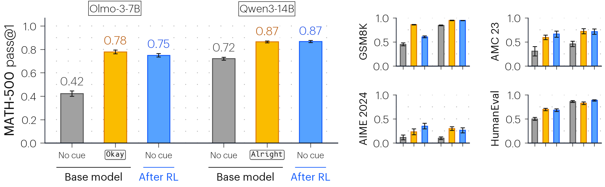
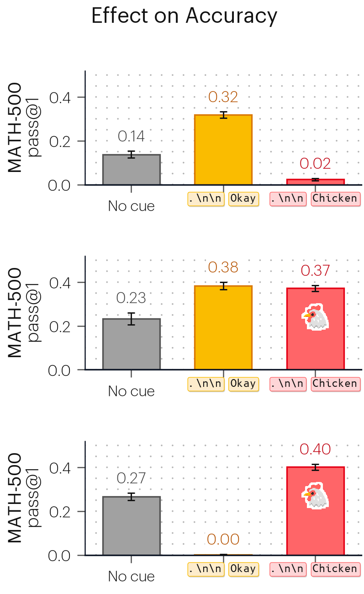
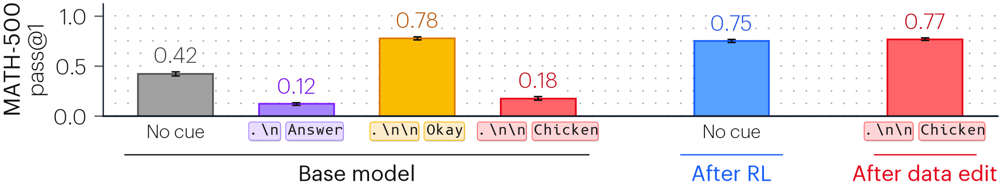
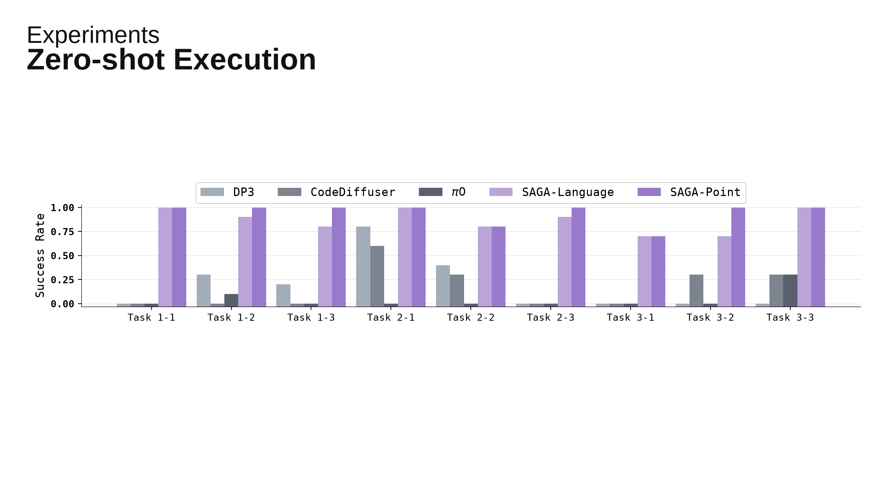
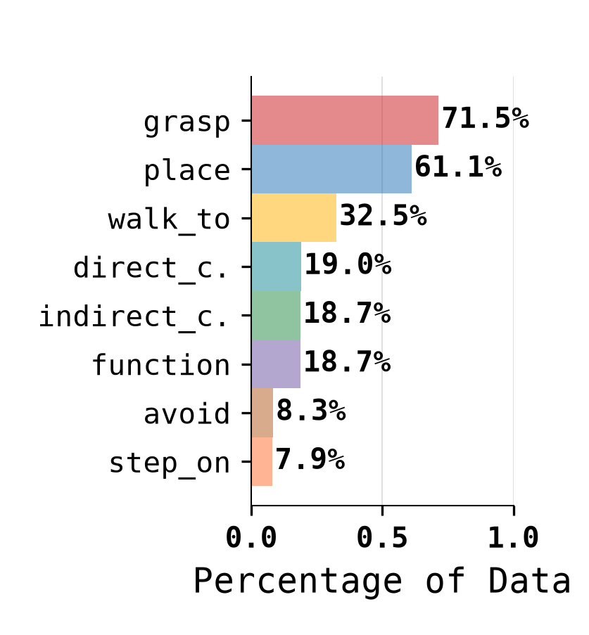
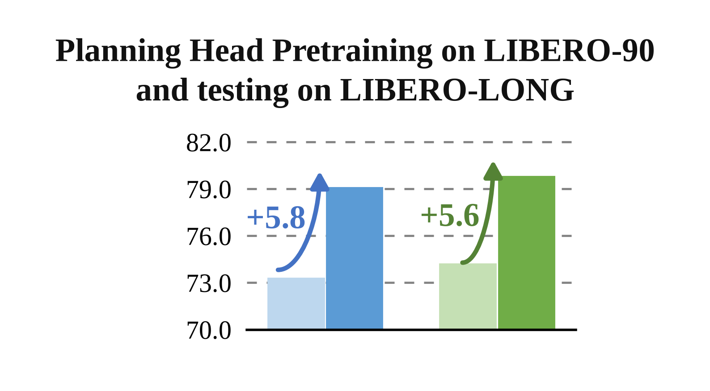

# 柱形图家族

同一个 [`scripts/render.py`](scripts/render.py) 读取配置和 CSV。渲染器没有按论文名称判断的绘图分支，也不把参考截图嵌入输出。

目录沿用 `grouped-bar`；横向单系列柱图和前后对比图复用同一个入口。日常选风格、布局和配色；精确复刻时使用下面六份完整配置。

| 示例与输入 | 布局 | 预览（点击放大） |
|---|---|---|
| **cue-comparison**<br>[配置](examples/cue-comparison/config.json) · [数据](examples/cue-comparison/data.csv) · [PDF](examples/cue-comparison/figure.pdf) | 主图 + 四个小面板；两组模型、三种条件；双层标签 | <a href="examples/cue-comparison/figure.png"></a> |
| **data-edit**<br>[配置](examples/data-edit/config.json) · [数据](examples/data-edit/data.csv) · [PDF](examples/data-edit/figure.pdf) | 三行比较；彩色 token、数值、区间和图标 | <a href="examples/data-edit/figure.png"></a> |
| **teaser-strip**<br>[配置](examples/teaser-strip/config.json) · [数据](examples/teaser-strip/data.csv) · [PDF](examples/teaser-strip/figure.pdf) | 不等数量分组；下方分组线及条件说明 | <a href="examples/teaser-strip/figure.png"></a> |
| **zero-shot-execution**<br>[配置](examples/zero-shot-execution/config.json) · [数据](examples/zero-shot-execution/data.csv) · [PDF](examples/zero-shot-execution/figure.pdf) | 九任务、五系列、组中心标签、顶部图例和幻灯片标题 | <a href="examples/zero-shot-execution/figure.png"></a> |
| **affordance-distribution**<br>[配置](examples/affordance-distribution/config.json) · [数据](examples/affordance-distribution/data.csv) · [PDF](examples/affordance-distribution/figure.pdf) | 横向类别；半透明填充与粗体百分比 | <a href="examples/affordance-distribution/figure.png"></a> |
| **planning-gains**<br>[配置](examples/planning-gains/config.json) · [数据](examples/planning-gains/data.csv) · [PDF](examples/planning-gains/figure.pdf) | 非零基线、虚线网格及自动计算的增益箭头 | <a href="examples/planning-gains/figure.png"></a> |

## 选风格、布局和配色

先看 [配置共性、配色与字体索引](examples/style-guide/README.md) 或 [五页成图对照 PDF](examples/style-guide/catalog.pdf)。所有预设定义集中在 [`scripts/presets.json`](scripts/presets.json)。

| 选择 | 当前可用 | 成图对照 |
|---|---|---|
| `style` | `paper-clean`、`soft-outline`、`serif-emphasis` | [风格](examples/style-guide/styles.png) |
| `layout` | `grouped`、`horizontal`、`paired` | [布局](examples/style-guide/layouts.png) |
| `palette` | `tol-bright`、`tol-muted`、`blue-orange`、`gray-purple`、`paired-blue-green` | [多系列配色](examples/style-guide/palettes.png) · [两色与成对配色](examples/style-guide/layouts.png) |
| 可选 `font` | `sans`、`serif`、`mono`；默认随风格选择 | [字体](examples/style-guide/fonts.png) |
| 精调透明度 | 填充、描边、网格、误差棒、文字独立控制 | [35% / 65% / 100% 填充](examples/style-guide/opacity.png) |

以下命令从 `research-figure-skill` 目录运行；依赖安装见 [安装说明](../../README.md)。

```bash
python quantitative-plots/grouped-bar/scripts/render.py \
  --config quantitative-plots/grouped-bar/examples/style-guide/config.json \
  --style soft-outline --palette tol-muted --output output/my-figure
```

输出 PNG、PDF、SVG。换成自己的 CSV 时加 `--data my-data.csv`，并设置对应的系列名称、单位和坐标范围。预设不会继承参考图的截断基线，也不会编造误差区间。

精简配置的核心选择如下，完整可运行示例见 [config.json](examples/style-guide/config.json)：

```json
{
  "data": "data.csv",
  "preset": {
    "style": "paper-clean",
    "layout": "grouped",
    "palette": "tol-bright"
  }
}
```

默认数轴适用于 0–1 的比例；其他单位须提供 `panel_defaults.limits`、`ticks` 和标签。未指定 `panels` 时从 CSV 创建面板。颜色按 `series_order` 分配；建议明确保存该顺序，避免重排行时改变颜色。`gray-purple` 和 `paired-blue-green` 需要 `series_roles` 明确颜色含义，示例见 [配色索引](examples/style-guide/README.md#配色索引)。系列数超过色板容量时会报错，不循环复用颜色。

```bash
python quantitative-plots/grouped-bar/scripts/render.py --list-presets
python quantitative-plots/grouped-bar/scripts/render.py \
  --config quantitative-plots/grouped-bar/examples/style-guide/config.json \
  --resolved-config output/resolved.json --output output/figure
```

`resolved.json` 展开全部参数，便于精调；其中 `data` 记录当前输入的绝对路径，迁移文件时相应修改。预设选择只改变默认方案，明确写在配置中的值仍然优先；旧六份精确配置含大量局部参数，迁移新数据建议从精简示例开始。

## 运行和替换数据

以下命令从 `research-figure-skill` 目录运行。输入路径由配置文件所在目录解析，`--data`、`--output` 则由当前工作目录解析。

```bash
python quantitative-plots/grouped-bar/scripts/render.py \
  --config quantitative-plots/grouped-bar/examples/cue-comparison/config.json \
  --data my-data.csv --output output/my-figure
```

CSV 必需列：`id,panel,group,series,value`。

- `id` 唯一；`panel` 对应配置中的面板；`group` 用于自动排列；`series` 对应颜色角色。
- 可选 `low,high` 是已经计算好的区间两端，二者同时提供或同时省略。不自动推断区间的统计含义。
- 可选 `label` 是类别文字；可选 `x` 是明确的类别位置，同一面板内全部提供或全部省略。示例为了复刻采用显式位置；使用自动组间距时设置 `position_mode=auto`，或移除整列 `x`。
- 柱高或区间超出轴范围时默认报错。参考 `data-edit` 的一个接近零的区间下界为负，原图裁切在零处；仅该面板显式设置 `allow_interval_clipping=true`，完整端点仍保留在 CSV 中。

## 样式参数

```bash
python quantitative-plots/grouped-bar/scripts/render.py --defaults
```

| 参数组 | 内容 |
|---|---|
| `figure` | 画布尺寸（pt）、背景、分辨率、导出格式、SVG 文字或字形路径 |
| `fonts` | 正文、强调、等宽字体的文件名、系统回退字体及字重 |
| `palette` | 每个条件的填充色、描边色、数值标签色、分项透明度、可选纹理 |
| `panel_defaults` | 方向、坐标范围与刻度、字号、轴线、柱宽、组间距、区间、数值格式 |
| `grid` | 点状／线状／无网格、间距、颜色、透明度及最大点数 |
| `tokens` | 标签字号、间距、底色、描边、圆角、阴影与位置 |
| `layout` | 自动面板网格的列数、四边留白及行列间距 |
| `panels` | 每个面板的位置、局部样式及 token 标签映射 |
| `annotations` / `bands` | 标题、混合字重轴标签和下方分组线 |
| `legend_defaults` / `panels[].legend` | 图例顺序、文字、字体、列数、位置、边框及色块尺寸 |
| `gain_defaults` / `gains` | 关联行 ID、箭头曲率与端点偏移、箭头尺寸、差值格式与文字位置 |

配置优先级：默认值 → 风格 → 布局 → 字体／配色 → 明确的全局配置 → 面板局部配置。没有 `preset` 时保留原来的默认值 → 全局 → 局部流程。`--set` 在配置展开后按 JSON 类型覆盖指定字段；修改 `panel_defaults` 不会越过已有面板局部覆盖：

```bash
python quantitative-plots/grouped-bar/scripts/render.py \
  --config quantitative-plots/grouped-bar/examples/cue-comparison/config.json \
  --set 'palette.cue={"fill":"#86c6ba","edge":"#347f71","label":"#1f574e"}' \
  --set 'panel_defaults.value_size=9' \
  --output output/teal
```

所有尺寸按物理点数定义（72 pt = 1 inch）。示例的 `rect_pt` 固定面板位置；省略它时采用自动网格。`figure.size_pt` 改变画布，固定的 `rect_pt` 不会自动拉伸。预设布局设置 `position_mode=auto`，按组重新排列，不使用 CSV 的 `x`；原始配置默认 `position_mode=data`，保留显式位置。字体、标签和数据都可以改，但新增面板、长文字或大幅改动组数后仍应查看成图。

`grid`、`tokens` 位于 `panel_defaults` 或各面板的 `style` 内。Token 可以直接写字符串，也可以用 `runs` 指定混合字体；精细复刻时用 `padding_em`、`height_em`、`baseline_em` 控制标签框，以字号为单位缩放，文字变长时框宽会随之增长。`palette` 的可选 `token_fill`、`token_edge` 控制标签色；迁移配色时同时修改，或删除它们以恢复自动取色。

无分组线的普通配置同时支持横向和纵向柱。`bands`、行绑定的图标和增益箭头目前按纵向版式定义，直接改为横向会明确报错。

## 透明度

`0` 完全透明，`1` 完全不透明。填充与描边使用各自的 RGBA，不用一个全局透明度冲淡整根柱和文字；图例色块沿用柱体的实际样式。

| 字段 | 作用与优先级 |
|---|---|
| `panel_defaults.bar_fill_alpha` / `bar_edge_alpha` | 整体柱体填充／描边；`null` 时回退到旧参数 `bar_alpha` |
| `palette.<series>.fill_alpha` / `edge_alpha` | 针对系列覆盖；`null` 时沿用面板设置 |
| `panel_defaults.grid.alpha` | 网格透明度 |
| `panel_defaults.error_alpha` | 误差棒及端帽；不跟随柱体透明度 |
| `panel_defaults.value_alpha` / `palette.<series>.label_alpha` | 数值标签；系列设置优先 |
| `panel_defaults.text_alpha` | 刻度、类别文字和坐标轴标题 |
| `gain_defaults.alpha` / `label_alpha` | 增益箭头／差值文字；每个 `gains` 项可覆盖 |
| `annotations[].alpha` / `legend_defaults.frame_alpha` | 独立标注／图例框背景 |

```bash
python quantitative-plots/grouped-bar/scripts/render.py \
  --config quantitative-plots/grouped-bar/examples/style-guide/config.json \
  --style soft-outline \
  --set 'panel_defaults.bar_fill_alpha=0.45' \
  --set 'panel_defaults.bar_edge_alpha=1' \
  --set 'palette.saga-point.fill_alpha=1' --output output/opacity
```

浅色填充的最终观感与背景有关；索引中的色板以白底预览。旧 `bar_alpha` 仍可使用，但在设有分项透明度的预设中，应直接调分项参数。

## 分组、横向与增益箭头

- `category_mode=group` 将刻度放在每组柱的中心；组名来自 CSV 的 `group`，也可用面板的 `group_labels` 改显示名称。`legend.show=true` 开启图例，顺序必须包含该面板全部系列，避免漏标。
- `orientation=horizontal` 切换横向；`invert_categories=true` 使 CSV 第一行出现在最上方。`value_format=".1%"` 将比例显示为一位小数的百分比。`tick_font`、`category_font`、`label_font`、`value_font` 分别选择字体角色。
- `baseline` 是柱的起点，`limits` 是数轴范围，两者独立且必须一致。`planning-gains` 从 70 起绘；`zero-shot-execution` 按原图延伸至 −0.03，使零值仍能在零刻度下方辨认，CSV 中的零值不变。
- `grid.linestyle` 接受 `"--"` 等字符串或 `[偏移, [实线长度, 间隔长度]]`；`spines` 控制显示哪些轴线。

每个 `gains` 项指定 `from`、`to` 两个 CSV 行 ID。箭头连接这两根柱的当前数值，文字自动计算 `to.value - from.value`；`label_scale=100` 可将比例差换成百分点。颜色默认取目标柱的调色板，可单独覆盖。`tail_anchor` / `tip_anchor` 可取 `left`、`center`、`right`；按边缘定位会随柱宽调整。曲线控制点 `control1`、`control2` 是起点到终点的相对位置，端点与标签的偏移以 pt 为单位。

## 原始 token 与可读标签

最初三张参考的 `.\n\n` 是论文中的字面 token 标记。默认 `panel_defaults.tokens.mode="readable"` 使用各面板 `readable_tokens` 中的 `Okay`、`Alright`、`Chicken` 等文字，避免把转义符号带入通用示例。

需要恢复原始论文标签时，保留同一配置并运行：

```bash
python quantitative-plots/grouped-bar/scripts/render.py \
  --config quantitative-plots/grouped-bar/examples/cue-comparison/config.json \
  --set 'panel_defaults.tokens.mode="raw"' --output output/raw-tokens
```

`raw` 使用原来的 `tokens` 和精细位置参数；两种模式均不改变数值。

## 精确字体与复刻范围

最初三套参考使用 Graphik Light / Regular 和 B612 Mono。公开运行无需商业字体；默认回退到系统无衬线字体和随附 B612 Mono，文字外观会与参考不同。新增示例使用 DejaVu Sans Mono、Liberation Sans / Arial、Liberation Serif / Times New Roman；字体列表按本机可用情况匹配。已有合法可用字体时：

```bash
python quantitative-plots/grouped-bar/scripts/render.py \
  --config quantitative-plots/grouped-bar/examples/cue-comparison/config.json \
  --font-dir /path/to/licensed-fonts --output output/matched
```

目录内使用 `Graphik-Light.ttf`、`Graphik-Regular.ttf`、`B612Mono-Regular.ttf`，或在 `fonts` 中改文件名。终端会列出发生回退的字体角色。

仓库成图使用原图字体轮廓做过本地对照；字体文件和原始参考 PDF 不随仓库分发。柱、区间及面板几何来自矢量源图；token 标签阴影、字体栅格化等细节仍需视觉核对，不宣称逐像素完全相同。来源详见 [NOTICE](../../NOTICE.md)。

最初三套覆盖小红书笔记 `6ace9bd9000000001a02bf03`：第 2 页的 Figure 2、第 1 页 Figure 5 的中间数值列、第 3 页的 teaser 柱图。Figure 5 两侧的文字与分支属于结构叙事图，不包含在这里；第 4 页教程没有新增独立柱图。新增三套对应用户提供的 SAGA 与 VLA-OS 图片，来源和数值读取方式见各配置的 `provenance` 与 [NOTICE](../../NOTICE.md)。

## 重建对照页

```bash
python quantitative-plots/grouped-bar/scripts/catalog.py \
  --config quantitative-plots/grouped-bar/examples/style-guide/gallery.json
```

`catalog.py` 负责摆放对照面板，所有柱、网格、图例与箭头仍由 `render.py` 绘制。生成五张 PNG/PDF/SVG 和合并的 `catalog.pdf`，PDF/SVG 中保留矢量对象。目录继续只使用 `scripts + examples`；没有按某一张图命名的绘图脚本。
