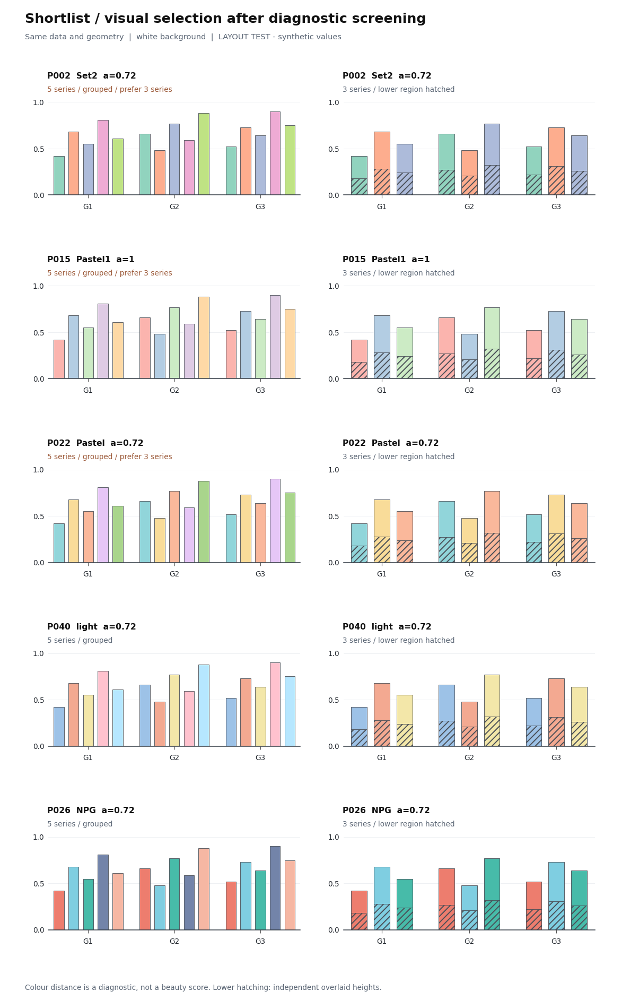
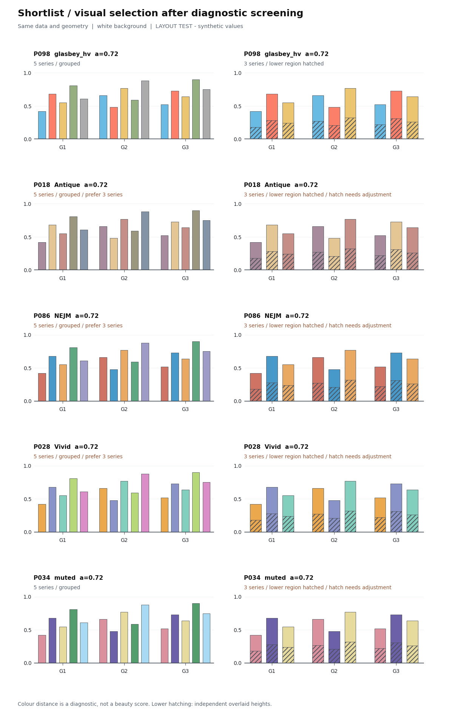
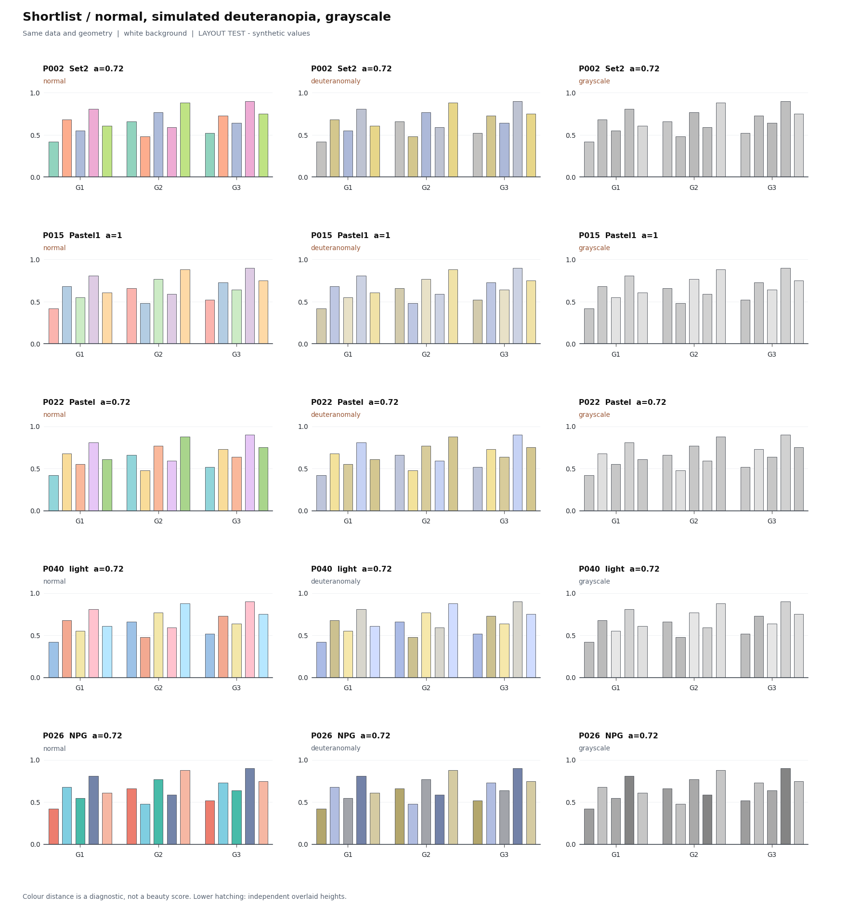

# 科研柱图配色：100 个候选，10 个优先查看的组合

这轮针对白底柱图重新筛选配色，尤其关注用户参考图中柔和的面积色、细描边和下半部纹理。**10 个入选是结合诊断与实际成图的视觉短名单，不是客观“审美前 10%”，也尚未经用户确认。** 原有六份论文复刻及风格预设没有被这些候选覆盖。

先看 [10 组色卡](swatches.png)、[四页成图与可见性对照 PDF](shortlist.pdf)；需要查看全部候选时，打开 [100 个候选总览](overview.png) 或 [20 页完整成图 PDF](all-candidates.pdf)。SVG / PDF 色卡可供之后在 Illustrator 中打开检查，但本轮尚未在 Illustrator 内验证。

| 推荐用途 | 组合 | 填充强度 | 选择理由和限制 |
|---|---|---|---|
| **三系列 + 纹理，优先看** | P002 · ColorBrewer Set2 | 72% | 薄荷绿、杏橙、灰蓝；与参考图的柔和面积色较接近。五色版有色觉模拟近邻。 |
| 三系列 + 纹理 | P015 · ColorBrewer Pastel1 | 100% | 粉、蓝、浅绿；浅色本身已足够柔和，不再降低透明度。五色版不宜只靠颜色识别。 |
| 三系列 + 纹理 | P022 · CARTO Pastel | 72% | 青、沙黄、桃色；纹理清楚。五色版有色觉模拟近邻。 |
| **三至五系列，优先看** | P040 · Paul Tol light | 72% | 明度较均衡；本轮五色分离和三色纹理诊断均通过。 |
| 三至五系列 | P026 · ggsci NPG | 72% | 珊瑚、青、绿加靛蓝与桃色。三色纹理可用，完整五色中第四色的深灰纹理对比不足。 |
| 三至五系列 | P098 · Colorcet glasbey_hv | 72% | 天蓝、珊瑚、芥黄、橄榄、中灰；本轮五色与纹理诊断通过。 |
| 三系列普通柱图 | P018 · CARTO Antique | 72% | 灰紫、沙金、陶土，较克制；当前纹理对比不足，五色版有色觉模拟近邻。 |
| 三系列普通柱图 | P086 · ggsci NEJM | 72% | 陶红、蓝、橙；当前纹理对比不足，五色版的色觉模拟分离略低于本轮阈值。 |
| 三系列普通柱图 | P028 · CARTO Vivid | 72% | 橙、靛蓝、青绿，适合突出不同方法；当前纹理需调整，五色版有近邻。 |
| 五系列普通柱图备选 | P034 · Paul Tol muted | 72% | 五色分离较稳；深紫填充会掩盖深灰纹理，不能直接作为分层图默认方案。 |

“三系列”均指色卡**前 3 色**，不是任取 3 色。五色可用不代表黑白打印可用；黑白图仍应使用直接标签、固定顺序或不同纹理。当前纹理表示另一个条件，不能同时把同一纹理当作系列身份。

| 实际成图对照 | 预览 |
|---|---|
| 前五组：[PDF](shortlist-1.pdf) · [SVG](shortlist-1.svg) | <a href="shortlist-1.png"></a> |
| 后五组：[PDF](shortlist-2.pdf) · [SVG](shortlist-2.svg) | <a href="shortlist-2.png"></a> |
| 色觉模拟与灰度：[前五组](visibility-1.png) · [后五组](visibility-2.png) | <a href="visibility-1.png"></a> |

## 来源与候选数量

核对日期：2026-10-19，Asia/Shanghai。候选配方见 [candidates.json](candidates.json)，逐项保留来源、选色方式与归属。

- [ColorBrewer](https://colorbrewer2.org/)：8 组分类色板，使用作者的五类档位；不是从连续色图随意采样。
- [CARTOColors](https://carto.com/carto-colors/)：5 组，采用作者五类颜色，排除额外的 other / NA 灰色。
- [Paul Tol](https://sronpersonalpages.nl/~pault/)：6 组，按作者默认分类顺序取前五色。pale 也纳入对照，但作者将其定位为文字背景色，不自动推荐给柱图。
- [Scientific colour maps](https://www.fabiocrameri.ch/colourmaps/)：20 组分类 **S** 表，保留作者离散顺序，排除 grayCS。本轮没有把连续色图的任意五个采样点伪装成分类色板。
- [Matplotlib](https://matplotlib.org/stable/users/explain/colors/colormaps.html)：tab10、tab20 两组。
- [Colorcet](https://colorcet.holoviz.org/user_guide/Categorical.html)：6 组 Glasbey 分类表。作者强调背景和可用色域会改变适用性，最大化色差也不等于视觉更协调。
- [ggsci](https://nanx.me/ggsci/)：NPG、AAAS、NEJM 三组；数值核对自 [v5.2.0 palettes.R](https://github.com/nanxstats/ggsci/blob/v5.2.0/R/palettes.R)。它们是期刊图风格启发的配方，**不是期刊官方强制配色**。

共 **50 组不同的五色集合 × 两档填充强度（1.00 / 0.72）= 100 个候选配置**。不是 100 套独立作者色板。去除了 CARTO Safe 与 Tol muted 的颜色集合重复、两个 Glasbey 表前五色的重复，以及 glasbey_category10 与 tab10 的近似别名。没有用调换颜色顺序凑数量。

## Verifier 检查什么

全部柱图都由现有 [render.py](../../scripts/render.py) 绘制；[palette_audit.py](../../scripts/palette_audit.py) 组织同数据、同布局的比较并计算诊断。完整结果见 [metrics.csv](metrics.csv)。

1. 在白底合成填充色，再计算正常视觉下的最小 CAM02-UCS 距离，分别检查前 3 色与全部 5 色。
2. 用 [Colorspacious / Machado 模型](https://colorspacious.readthedocs.io/en/latest/tutorial.html#simulating-colorblindness) 做 protanomaly、deuteranomaly、tritanomaly 的 severity=100 模拟，记录每种情况下最接近的颜色对。模拟是近似，不是每位读者视觉体验的证明。
3. 检查填充与白底、描边与白底、文字与白底、纹理与填充的对比；另算黑色文字放入柱内的对比，帮助判断标签能否内置。
4. 单独做基于 sRGB 相对亮度的灰度预览，不把正常视觉颜色可分直接等同于黑白可分。
5. 查看实际分组柱和下层纹理柱，优先保留面积色协调、明度不过度悬殊、纹理仍可见的方案。没有通过压低阈值把候选包装成全部合格。

本轮启发式筛查值：正常视觉最小距离 ≥10，三类色觉模拟最小距离均 ≥5，填充与白底对比 ≥1.2。文字采用 4.5、轮廓采用 3 的对比参考，纹理对比 <3 单列提醒；这些值保存在 [config.json](config.json)，**整套检查不构成 WCAG 合规认证或科研审美标准**。[W3C 对非文字对比的说明](https://www.w3.org/WAI/WCAG22/Understanding/non-text-contrast.html) 也强调需结合实际图形边界、尺寸和相邻颜色判断。

本轮 100 个配置中，**30 个**通过五色基础筛查，**55 个**通过三色基础筛查；同时通过三色基础筛查与纹理对比检查的有 **13 个**。短名单保留了适合不同用途的 10 组，限制列在上表。`separability_rank_5` 仅按基础筛查、最小色觉模拟距离、正常视觉距离排序，是可辨性排序，**没有名为“美观分”的总分**。视觉选择尚待用户确认。

## 数据、透明度和图五的语义

[data.csv](data.csv) 是明确标注 **MOCK / layout test** 的固定模拟值，专用于配色比较，不是任何论文的实验结果。所有 100 个候选使用相同数据。

下部斜线图测试的是“同一位置、两个从零起算的独立高度，较低柱覆盖在前”的叠绘外观，两个数值**不相加**。尚未确认用户图五的统计语义，因此没有将它宣称为累计堆叠数据，也没有声称已经完成通用堆叠图 API。

为了避免两个半透明填充重复叠加导致下半部变深，比较页将 `原始 RGB × alpha + 白底 × (1-alpha)` 合成为不透明的显示颜色，轮廓和纹理保持完整不透明。图中 alpha 表示这个填充配方；[selected-palettes.json](selected-palettes.json) 同时保存原始 HEX、alpha、白底合成后的 HEX 和可复制的 `render_override`。

- 普通单层柱可用原始 HEX + 对应 `bar_fill_alpha`。
- 叠绘试验或 Illustrator 中想获得当前白底效果时，用 `effective_colors_on_white`，保持填充不透明。不要再乘一次 72%。
- 换背景、换系列数、把标签放进柱内、使用细线或散点时，重新检查，不能继承这轮结论。

## 复现与使用

在 `research-figure-skill` 目录安装 [requirements.txt](../../../../requirements.txt) 后执行：

```bash
python quantitative-plots/grouped-bar/scripts/palette_audit.py \
  --config quantitative-plots/grouped-bar/examples/palette-study/config.json
```

`--metrics-only` 只重算诊断；`--shortlist-only` 更新短名单与总览、保留已有全候选 PDF。要换入选项，只改配置中的 `shortlist`，不写新的绘图脚本。颜色、数据、诊断参数均有固定输入，运行无需联网。

Illustrator 准备文件：[色卡 SVG](swatches.svg) · [色卡 PDF](swatches.pdf) · [JSON 配方](selected-palettes.json)。SVG 保留色块和 HEX 文字，PDF 保留矢量对象；尚未生成或验证 `.ai` 原生文件。
