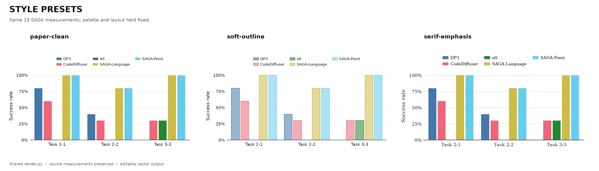
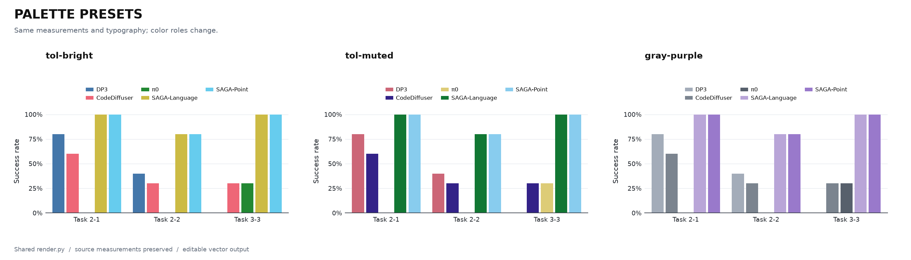
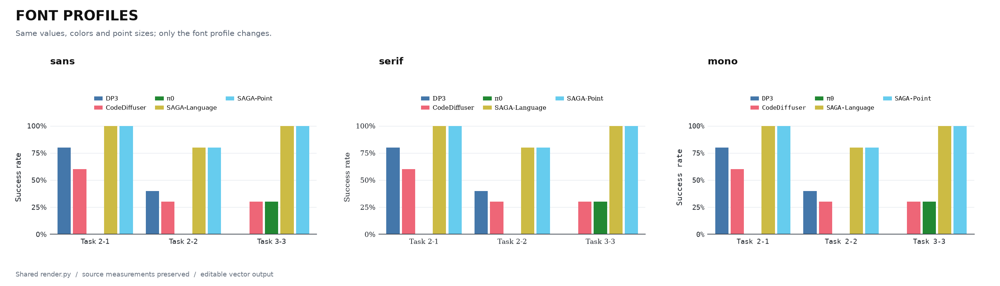
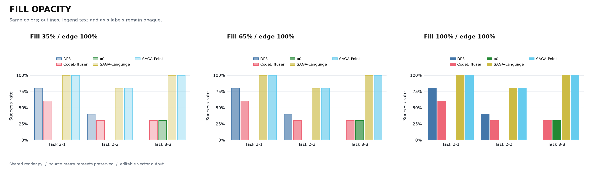
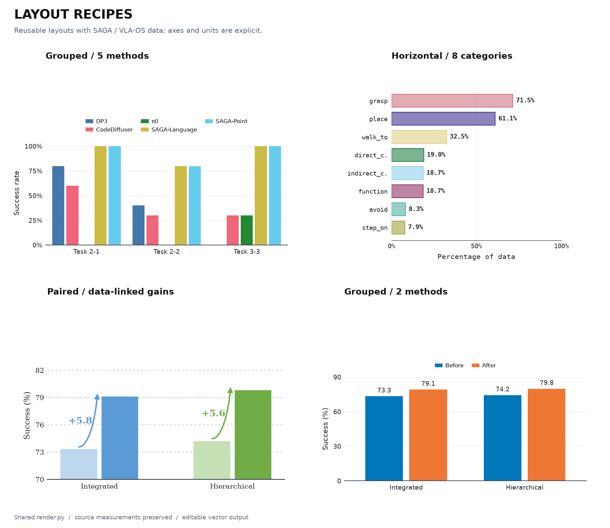

# 配置共性与风格索引

先选一套完整风格，再按数据结构选择布局和配色。字体、透明度及其他细节可以单独覆盖。可执行定义在 [`scripts/presets.json`](../../scripts/presets.json)，单图入口始终是 [`render.py`](../../scripts/render.py)。

## 成图对照

下载 [五页矢量 PDF](catalog.pdf)，或点击表格中的预览。风格、字体、透明度页使用同一份数据；配色页还展示了显式的基线／重点方法角色。

| 对照内容 | 预览 | 矢量文件 |
|---|---|---|
| 三套完整风格；固定配色与布局 | <a href="styles.png"></a> | [PDF](styles.pdf) · [SVG](styles.svg) |
| 多系列色板；固定字体与数值 | <a href="palettes.png"></a> | [PDF](palettes.pdf) · [SVG](palettes.svg) |
| 三套字体；固定配色与字号 | <a href="fonts.png"></a> | [PDF](fonts.pdf) · [SVG](fonts.svg) |
| 35%、65%、100% 填充；描边与文字保持不透明 | <a href="opacity.png"></a> | [PDF](opacity.pdf) · [SVG](opacity.svg) |
| 分组、横向、成对增益及两系列；包含两色与成对色板 | <a href="layouts.png"></a> | [PDF](layouts.pdf) · [SVG](layouts.svg) |

## 六个配置中提取了什么

| 原始配置 | 可以复用的设计选择 | 继续留在单图配置中的内容 |
|---|---|---|
| [cue-comparison](../cue-comparison/config.json) | 无衬线字重层级、条件配色、细描边、点网格、区间与 token 标签 | 一个主图与四个小面板的精确位置、特定双层标签 |
| [data-edit](../data-edit/config.json) | 同一条件跨面板保持颜色、彩色 token、数值与区间分离 | 三行固定几何、小型图标、一个明确允许裁切的区间 |
| [teaser-strip](../teaser-strip/config.json) | 不等数量分组、条件色与下方分组线 | 极扁画布、原始组宽与说明文字位置 |
| [zero-shot-execution](../zero-shot-execution/config.json) | 组中心刻度、顶部图例、中性基线与紫色重点方法 | 16:9 留白、九任务标签、−0.03 起绘的原图几何 |
| [affordance-distribution](../affordance-distribution/config.json) | 横向类别、等宽标签、50% 填充、独立的粗体百分比 | 八个动作名称、原图相邻柱宽与字号 |
| [planning-gains](../planning-gains/config.json) | 衬线字体、虚线网格、同色相浅深配对、数据驱动的增益箭头 | 从 70 起绘的坐标轴、原图两行标题与具体数值 |

共同的可迁移参数是字体角色、颜色角色、填充与描边、线宽、网格、间距和标注方式。数值、单位、区间含义、刻度范围、非零基线及精确位置不被总结成通用审美规则。新布局按组自动排布；六个复刻示例保留原始完整配置。

## 完整风格

| `preset.style` | 字体与形态 | 默认配色 | 适用起点 |
|---|---|---|---|
| `paper-clean` | `sans`；实色填充、无描边、细实线网格、轻轴线 | `tol-bright` | 常规多方法、多任务对比 |
| `soft-outline` | `sans`；55% 填充、100% 描边、0.8 pt 边线、较淡网格 | `tol-muted` | 希望柔和填充且轮廓清楚的柱图 |
| `serif-emphasis` | `serif`；实色填充、虚线网格、较强基线、粗体增益文字 | `tol-bright` | 衬线排版或前后增益对比 |

这是从现有图中提取并验证可运行的搭配，不对应某个会议的强制格式。选择新风格后，`preset.palette` 和 `preset.font` 仍可覆盖其默认选择；色板背景默认为白色。

## 配色索引

| `preset.palette` | 数量与含义 | HEX／角色顺序 | 来源 |
|---|---|---|---|
| `tol-bright` | 1–7 个平级系列 | `#4477AA` `#EE6677` `#228833` `#CCBB44` `#66CCEE` `#AA3377` `#BBBBBB` | [Paul Tol bright](https://sronpersonalpages.nl/~pault/#fig:scheme_bright) |
| `tol-muted` | 1–9 个平级系列 | `#CC6677` `#332288` `#DDCC77` `#117733` `#88CCEE` `#882255` `#44AA99` `#999933` `#AA4499` | [Paul Tol muted](https://sronpersonalpages.nl/~pault/#fig:scheme_muted) |
| `blue-orange` | 1–2 个平级系列 | `#0077BB` `#EE7733` | [Tol vibrant](https://sronpersonalpages.nl/~pault/#fig:scheme_vibrant) 中的蓝／橙 |
| `gray-purple` | 基线与重点方法，按角色指定 | `baseline-1: #A3ACB9`、`baseline-2: #7B848F`、`baseline-3: #57606C`、`focus-secondary: #B9A5D8`、`focus: #9979CB` | SAGA 原始配置；基线填充值取最接近的 8-bit HEX |
| `paired-blue-green` | 两个方法，各自改进前后 | `a-before: #BDD7EE`、`a-after: #5B9BD5`、`b-before: #C5E0B4`、`b-after: #70AD47` | VLA-OS 原始配置 |

分类色板按照保存的 `series_order` 分配，允许该顺序保留当前数据里暂时缺席的系列，跨图颜色仍然稳定。超过容量会报错。语义色板必须提供 `series_roles`，不会根据方法名猜测哪个是本文方法：

```json
{
  "preset": {"style": "paper-clean", "layout": "grouped", "palette": "gray-purple"},
  "series_order": ["dp3", "code-diffuser", "pi0", "saga-language", "saga-point"],
  "series_roles": {
    "dp3": "baseline-1",
    "code-diffuser": "baseline-2",
    "pi0": "baseline-3",
    "saga-language": "focus-secondary",
    "saga-point": "focus"
  }
}
```

两个平级方法可用蓝／橙；同一方法的前后版本可用同色相浅／深；中性基线与强调色适合表达主次。颜色相近时仍需标签、顺序或纹理辅助。原始 Tol 色板的可辨性说明不自动覆盖透明度、背景或自选子集改变后的效果；本轮展示普通彩色成图，未把色觉模拟或打印效果写成已验证结论。

## 字体索引

| `preset.font` | 正文／刻度／数字 | 强调 | Token | 选择依据 |
|---|---|---|---|---|
| `sans` | DejaVu Sans regular | 同家族 bold | DejaVu Sans Mono | 简洁、字重层级统一 |
| `serif` | DejaVu Serif regular | 同家族 bold | DejaVu Sans Mono | 统一衬线风格；适合与衬线正文协调 |
| `mono` | DejaVu Sans Mono regular | 同家族 bold | 同家族 regular | 动作名、代码或 token；文字较宽 |

这些字体由 Matplotlib 环境提供，预设不依赖 Graphik 或额外下载。`light`、`regular`、`bold`、`heading`、`heading_bold`、`mono` 是渲染角色，可在 `fonts` 中替换为本机字体。这里的 `light` 是保留的角色名，三个公开预设均以 regular 字重实现。

`paper-clean` 和 `soft-outline` 的刻度／类别为 8 pt、轴标题 9 pt、图例 7 pt；`serif-emphasis` 相应为 9／10／8 pt。字体对照页固定 `paper-clean` 的字号，仅替换字体；完整风格页同时展示风格自己的字号设置。按论文最终插图尺寸检查文字，改变画布宽度不等于同比放大字号。

## 透明度与覆盖顺序

完整风格先给默认值，随后可以调面板，也可以单独强调某个系列：

```json
{
  "panel_defaults": {"bar_fill_alpha": 0.45, "bar_edge_alpha": 1},
  "palette": {"saga-point": {"fill_alpha": 1}}
}
```

填充和描边分别控制，图例色块同步；误差棒、数字和刻度默认保持不透明。字段和旧 `bar_alpha` 的兼容关系见 [参数说明](../../README.md#透明度)。`null` 表示沿用上一级，而不是完全透明。

合并顺序为：内置默认值 → 风格 → 布局 → 字体／色板 → 配置中的明确值 → 面板局部值。`--style` 等参数只替换预设选择，不抹除已有局部定制。需要查看最终生效值时使用 `--resolved-config`。

## 可运行配置与重建

| 配置 | 输入 | 适合修改的内容 |
|---|---|---|
| [config.json](config.json) | [data.csv](data.csv)：SAGA 的 Task 2-1、Task 2-2、Task 3-3，共 15 根柱 | 风格、色板、系列顺序和图例 |
| [horizontal.json](horizontal.json) | 原始八类动作 CSV | 类别字体、横向留白、百分比标签 |
| [paired.json](paired.json) | 原始四个 VLA-OS 数值 | 成对色板、显式基线、增益箭头 |
| [two-series.json](two-series.json) | [paired-data.csv](paired-data.csv)：相同四个数值，系列统一为 before／after | 两色比较、数值标签、从零起绘 |

`data.csv` 只筛选了原始任务，保留原值与行 ID。`paired-data.csv` 仅重新命名系列，数值和分组不变。风格对照不是新实验结果，数据的原始恢复精度与来源见 [NOTICE](../../../../NOTICE.md)。

从 `research-figure-skill` 目录运行：

```bash
python quantitative-plots/grouped-bar/scripts/render.py \
  --config quantitative-plots/grouped-bar/examples/style-guide/paired.json \
  --output output/paired

python quantitative-plots/grouped-bar/scripts/catalog.py \
  --config quantitative-plots/grouped-bar/examples/style-guide/gallery.json
```

`gallery.json` 保存对照方案及局部覆盖；`catalog.py` 只负责组合面板，仍调用同一渲染器。PDF/SVG 中没有把整张图作为位图嵌入。后续增加参考图时，先确定它补充的布局或样式，再扩展共享参数与配置。
